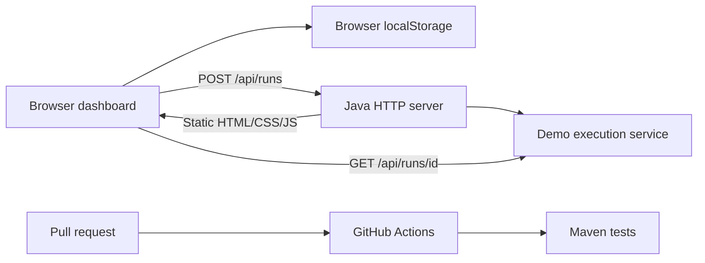
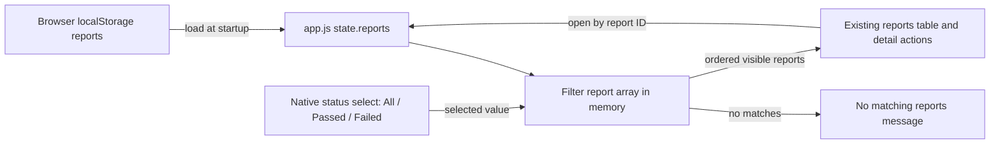

# Architecture

## Overview

The capstone has a dependency-free Java 17 HTTP server, a browser-based dashboard, and a deliberately simulated test runner. The browser stores test cases and report history in local storage. The Java server only serves the app and simulates asynchronous run status.

## Components

| Component | Responsibility |
|---|---|
| `DashboardServer` | Serves the UI assets and exposes health and demo-run endpoints using the JDK HTTP server. |
| `ExecutionService` | Creates in-progress run records, then completes them as Passed or Failed after a short scheduled delay. |
| `static/index.html` | Dashboard layout, login gate, test-case form, reports and confirmation dialogs. |
| `static/app.js` | Local storage, create/read/update/delete, search/filter, runner polling, and report history. |
| `static/styles.css` | Responsive dashboard styling and status indicators. |
| `src/test/java` | JUnit tests for execution transitions and HTTP endpoint behavior. |
| `.github/workflows/ci.yml` | Runs the Maven test suite on pull requests and pushes to `main`. |

## Data flow

1. The dashboard starts with a demo login gate. No credential validation or session security is provided.
2. Cases are loaded from local storage, or a few sample cases are shown on first use.
3. Create/edit/delete operations update browser storage and rerender the table. Deletion requires explicit confirmation.
4. On Run Test, the browser creates a local In Progress state and submits the case ID, name, and selected demo outcome to the Java server.
5. The Java runner returns a run ID. The browser polls for completion, updates the case's last result, and saves a report locally.
6. The reports page displays status, time, duration, and simulated failure details.

## US-103: Client-side report status filter

The status filter is a view over the reports already loaded into `state.reports`; it does not introduce another data store, API, or report lifecycle. This keeps US-102's browser-local report ownership and simulated-run boundary unchanged.

| Existing component / interface | US-103 responsibility |
|---|---|
| `static/index.html` reports page | Provide a visibly labeled native select with All, Passed, and Failed options. All is its default option; retain the existing reports table container and add a polite live region for the result count and no-match announcement. |
| `static/app.js` report state and renderer | Validate the loaded report value is an array before rendering. On selection change, filter `state.reports` in memory and render the resulting projection. Use `Array.filter` so the stored report order is retained. Keep report-detail actions keyed to the original report IDs in `state.reports`. |
| `static/styles.css` | Reuse the current `.filters select` form-control treatment and `.empty-state` visual pattern; no new styling system is required. |
| Browser `localStorage` | Remains the source of the full report list. The filter neither writes nor deletes report data. |

### Filter flow, behavior, and boundaries

At startup, `app.js` loads reports from local storage as it does today. The select starts at All and a render shows every report in existing order. A selection change calls the client-side report renderer without reloading the page; All uses the complete array, while Passed or Failed produces an in-memory filtered array. The displayed count represents the visible rows. Opening a report continues to resolve its ID against the full report collection, so filtering does not impair report details.

An empty stored report list keeps the existing “No execution reports yet” state. If reports exist but none match the selected status, show a distinct, clear “No matching reports” empty state. A no-match result is normal filter behavior, not a storage or runner error; changing the selection can reveal the reports again. The native select provides standard keyboard operation and the visible label explains its purpose.

After a filter change, update a polite live region with the visible result count or the no-match message without moving focus. If the stored report value parses as valid JSON but is not an array, do not call array methods on it or replace/delete it; show an actionable report-data error instead. This error is distinct from both empty states.

Filter selection is transient UI state only: do not add it to local/session storage or the report data model. It starts at All after a full page reload. In-page navigation may retain the current select value while the document remains loaded. Filtering issues no HTTP request and does not change run generation, report retention, or server responsibilities.

### Security, error handling, and testability

The browser processes only reports already available locally; no report data or selected status is sent to the Java server. Render report fields through the existing HTML-escaping helpers and retain existing storage read-error handling. Filtering must not mutate `state.reports` or call report persistence. The no-match state is separate from the existing storage-error toast behavior.

The behavior is deterministic for a given report array and selected status. Verify All/default and reload, each status subset, stable relative order, report-detail actions, no-match versus no-reports messaging, polite result announcements, unchanged stored report data, and the non-destructive invalid-data error state using a documented browser acceptance checklist. Run `mvn test` for existing Java regressions. The repository has no browser JavaScript test harness; this feature does not add test tooling or dependencies, so manual browser evidence is required for client behavior.

### Acceptance-criteria trace

| Criterion | Architectural path |
|---|---|
| AC-06 | Native labeled All/Passed/Failed select; All is the initial value and renders the full report array. |
| AC-07 | Change event filters in the browser, preserves input order, and leaves each row's report-detail action available. |
| AC-08 | Filter acts only on a derived in-memory view; it does not write/delete reports, and a document reload initializes the select to All. |
| AC-09 | An existing report list with zero matches renders the explicit no-matching-reports state, distinct from the no-reports-yet state. |
| AC-10 | A polite live region announces the visible result count or no-match state without moving focus. |
| AC-11 | A valid-JSON, non-array report value produces an actionable error without a rendering crash or change to stored data. |

**Approved decisions and trade-offs:** The two completed statuses remain Passed and Failed as specified; All includes every report currently loaded. A native select and an in-memory projection favor accessibility and minimal change over custom filter controls or cached derived state. The projection is transient, so a reload intentionally loses the selection. A polite live region supplements the native select so result changes are announced. Structurally invalid report data is reported without destructive repair. Because the repository has no browser test harness, use a documented manual browser checklist plus `mvn test` rather than adding test dependencies for this feature.

## API

- `GET /api/health` — returns server status.
- `POST /api/runs` — form-encoded case ID, title, and requested demo outcome; creates a run and returns its ID.
- `GET /api/runs/{id}` — returns In Progress or the final Passed/Failed status, duration, timestamp, and failure message.

## Security and operational boundaries

- The login is a UI demonstration only and must not be used to protect real data.
- The app uses no real secrets and makes no external network requests.
- Java validates the run outcome and limits the request body size. Browser-rendered user text is HTML-escaped.
- Case data and reports are not sent to the server for storage.
- The simulated result is not evidence that a real UI test passed. The optional outcome selector exists only to demonstrate both result states.

## Agentic SDLC customization

Workspace instructions give Copilot the project rules. `SDLC Orchestrator` guides eight sequential phases and delegates to a requirements, architecture, design-review, planning, implementation, code-review, verification, or PR-preparation specialist. Each phase specialist links to its matching prompt and skill. The dashboard review agent remains a focused read-only reviewer for US-102.

No lifecycle hook is installed because hidden automatic execution is unnecessary. Human approval gates control transition between phases and all publishing actions; Maven and CI provide explicit deterministic verification.
