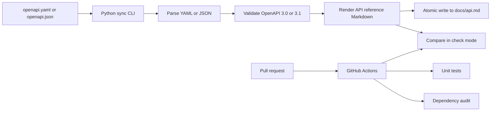

# Architecture

## Overview

The repository is a small Python command-line tool that validates an OpenAPI document and renders a deterministic Markdown reference. Contributors run it to update `docs/api.md`; a GitHub Actions pull request check verifies that the generated file is current.

## Components and responsibilities

| Component | Responsibility |
|---|---|
| `scripts/sync_openapi_docs.py` | Discover or accept an input spec, parse and validate it, render Markdown, and either atomically update output or verify it in check mode. |
| `openapi.yaml` | Minimal valid sample contract used to demonstrate and test synchronization. |
| `docs/api.md` | Generated API reference; contributors commit this file alongside contract changes. |
| `tests/` | Unit and integration coverage for generation, check mode, invalid inputs, and preservation of existing output. |
| `.github/workflows/openapi-docs.yml` | Runs tests, dependency auditing, and documentation consistency checks for relevant pull requests. |
| `requirements.txt` | Declares the YAML parser and OpenAPI validator used by the CLI. |
| `.github/` Copilot customizations | Project instructions, a review agent, a synchronization prompt, and an on-demand synchronization skill guide repeatable agent-assisted work. |
| `CHANGELOG.md` and `.github/PULL_REQUEST_TEMPLATE.md` | Record the initial release changes and provide the requested structured PR description and reviewer checklist. |

## Data flow

1. The CLI accepts an explicit `--spec` path or discovers exactly one root-level `openapi.yaml` / `openapi.json`.
2. The input is parsed with safe YAML loading or the JSON parser.
3. The CLI checks that the document is non-empty, declares OpenAPI 3.0.x or 3.1.x, and passes the OpenAPI validator.
4. The renderer walks paths and supported HTTP operations in stable order and formats parameters, request bodies, response codes, and response schemas.
5. Normal mode writes the fully rendered result atomically. Check mode compares the expected text with the existing output and reports stale or missing documentation without writing.
6. On pull requests that touch the contract or related implementation files, GitHub Actions runs tests, the dependency audit, and check mode. CI is read-only and never commits changes.

## Technology choices

- **Python 3.11+:** small standard-library CLI and `unittest` suite.
- **PyYAML:** safe parsing of YAML input; JSON uses the Python standard library.
- **openapi-spec-validator:** structural validation for supported OpenAPI documents.
- **GitHub Actions:** pull request automation, with `contents: read` permission.

## Error handling and security

- Validation and rendering complete before the output path is touched.
- Writes use a temporary file in the destination directory and atomic replacement.
- YAML uses `safe_load`; the tool does not evaluate arbitrary tags or retrieve external references.
- Errors identify the input path and next action where possible, and return a non-zero exit code.
- The workflow requires no repository secrets and grants only read access.
- Copilot customizations guide interactive work; deterministic validation remains in the CLI and CI workflow.

## Operational boundary

The PR workflow detects stale documentation and fails; it does not push generated changes. Contributors run `python scripts/sync_openapi_docs.py` and commit the updated `docs/api.md`. This matches the selected PR-check behavior while keeping CI safe and non-mutating.

No agent lifecycle hook is configured. A hook is unnecessary for this repository because synchronization is an explicit developer action and the GitHub Actions workflow provides deterministic validation at the pull request boundary.
