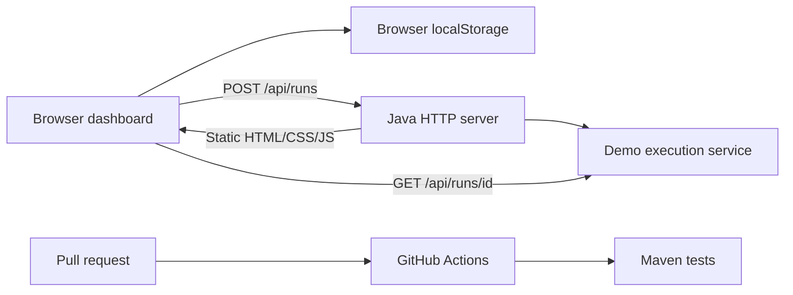

# Architecture

## Overview

The capstone has a dependency-free Java 17 HTTP server, a browser-based dashboard, and a deliberately simulated test runner. The browser stores test cases and report history in local storage. The Java server only serves the app and simulates asynchronous run status.

## Components

| Component | Responsibility |
|---|---|
| `DashboardServer` | Serves the UI assets and exposes health and demo-run endpoints using the JDK HTTP server. |
| `ExecutionService` | Creates in-progress run records, then completes them as Passed or Failed after a short scheduled delay. |
| `static/index.html` | Dashboard layout, login gate, test-case form, reports and confirmation dialogs. |
| `static/app.js` | Local storage, create/read/update/delete, search/filter, runner polling, and report history. |
| `static/styles.css` | Responsive dashboard styling and status indicators. |
| `src/test/java` | JUnit tests for execution transitions and HTTP endpoint behavior. |
| `.github/workflows/ci.yml` | Runs the Maven test suite on pull requests and pushes to `main`. |

## Data flow

1. The dashboard starts with a demo login gate. No credential validation or session security is provided.
2. Cases are loaded from local storage, or a few sample cases are shown on first use.
3. Create/edit/delete operations update browser storage and rerender the table. Deletion requires explicit confirmation.
4. On Run Test, the browser creates a local In Progress state and submits the case ID, name, and selected demo outcome to the Java server.
5. The Java runner returns a run ID. The browser polls for completion, updates the case's last result, and saves a report locally.
6. The reports page displays status, time, duration, and simulated failure details.

## API

- `GET /api/health` — returns server status.
- `POST /api/runs` — form-encoded case ID, title, and requested demo outcome; creates a run and returns its ID.
- `GET /api/runs/{id}` — returns In Progress or the final Passed/Failed status, duration, timestamp, and failure message.

## Security and operational boundaries

- The login is a UI demonstration only and must not be used to protect real data.
- The app uses no real secrets and makes no external network requests.
- Java validates the run outcome and limits the request body size. Browser-rendered user text is HTML-escaped.
- Case data and reports are not sent to the server for storage.
- The simulated result is not evidence that a real UI test passed. The optional outcome selector exists only to demonstrate both result states.

## Agentic SDLC customization

Workspace instructions give Copilot the project rules. A dashboard review agent is read-only and evaluates behavior against the user story. A prompt provides a focused task for reviewing/implementing a dashboard change; a skill gives a repeatable workflow for validating features and tests. No lifecycle hook is installed because hidden automatic execution is unnecessary; Maven and CI provide explicit deterministic verification.
